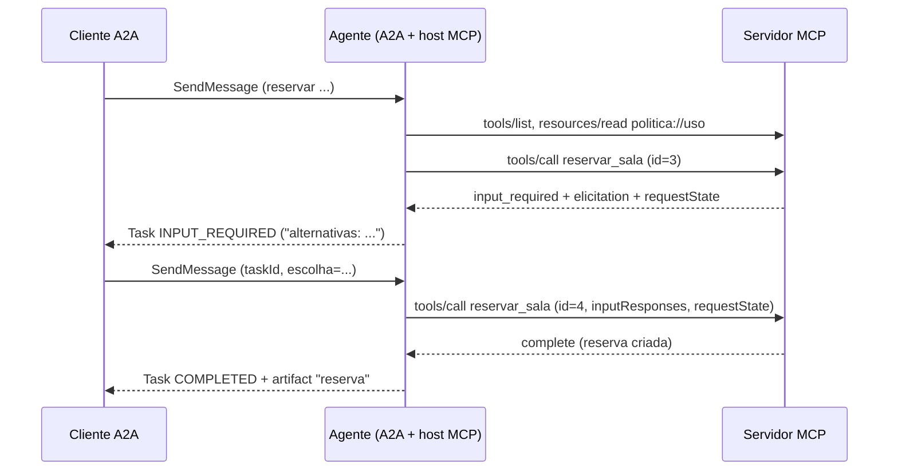

# 🚀 Desafio MBA Engenharia de Software com IA - Full Cycle


# 🌉 A Ponte: um agente A2A com MCP por dentro

Entrega do desafio **A Ponte** (MBA Engenharia de Software com IA, Full Cycle).

Dois processos separados, falando HTTP entre si:

| Processo | Pasta | Porta | Endpoints | Papel |
|---|---|:---:|---|---|
| 🧰 Servidor MCP | `servidor-mcp/` | `7301` | `/mcp` (Streamable HTTP) | Expõe as salas: 3 tools, 1 resource e o ciclo de MRTR |
| 🤖 Agente | `agente/` | `7300` | `/a2a` (JSON-RPC) e `/.well-known/agent-card.json` | Host MCP por dentro, servidor A2A por fora |



**Stack:** Python, SDK oficial `mcp==2.3.0` (revisão **2026-07-28** da spec MCP) e A2A **v1.0** no binding JSON-RPC 2.0, implementado sobre Starlette. As versões estão travadas nos `pyproject.toml` e nos `uv.lock` de cada processo. O agente não usa LLM: o pedido tem formato fixo e a decisão é por regra, então ele é determinístico.

---

## ▶️ Como rodar

**Pré-requisitos:** Python 3.11+ e o [uv](https://docs.astral.sh/uv/getting-started/installation/). O validador roda com o Python 3.10+ do sistema, sem dependências.

```bash
git clone https://github.com/gustcoder/desafio-a2a-com-mcp.git
cd desafio-a2a-com-mcp
```

### 1. A chave do `requestState`

O servidor MCP **não sobe** sem `REQUEST_STATE_SECRET`, e não existe valor padrão no código. Gere uma chave de 32 bytes aleatórios e exporte no terminal do servidor:

```bash
export REQUEST_STATE_SECRET=$(python3 -c "import secrets; print(secrets.token_hex(32))")
```

> Use a mesma chave enquanto quiser que um `requestState` já emitido continue válido, inclusive depois de um restart. Nunca versione o valor.

### 2. Terminal 1: servidor MCP (porta 7301)

```bash
cd servidor-mcp
uv sync
uv run python servidor.py
```

O stderr deste processo é o instrumento de depuração: cada request aparece com `method`, `id`, `name`, `traceparent` e, no retry, `retry=sim`.

### 3. Terminal 2: agente (porta 7300)

```bash
cd agente
uv sync
uv run python agente.py
```

### 4. Terminal 3: validador

Com os dois processos **recém-iniciados**, porque as reservas de uma execução mudam o resultado da seguinte:

```bash
python3 validador/validar.py --agente http://localhost:7300 --mcp http://localhost:7301
```

### Variáveis de ambiente (opcionais)

| Variável | Padrão | Processo |
|---|---|---|
| `REQUEST_STATE_SECRET` | *(obrigatória)* | servidor MCP |
| `MCP_HOST` / `MCP_PORT` | `127.0.0.1` / `7301` | servidor MCP |
| `A2A_HOST` / `A2A_PORT` | `127.0.0.1` / `7300` | agente |
| `A2A_URL` | `http://<A2A_HOST>:<A2A_PORT>/a2a` | agente (URL publicada no card) |
| `MCP_URL` | `http://127.0.0.1:7301/mcp` | agente |

### Teste rápido à mão

```bash
# card
curl -s http://localhost:7300/.well-known/agent-card.json

# sala ocupada: a Task para em TASK_STATE_INPUT_REQUIRED com "alternativas: sala-fusca, sala-mirante"
curl -s http://localhost:7300/a2a -H 'Content-Type: application/json' \
  -H 'traceparent: 00-4bf92f3577b34da6a3ce929d0e0e4736-00f067aa0ba902b7-01' \
  -d '{"jsonrpc":"2.0","id":1,"method":"SendMessage","params":{"message":{"messageId":"msg-1","role":"ROLE_USER","parts":[{"text":"reservar sala=sala-garagem inicio=2026-11-03T14:00:00-03:00 fim=2026-11-03T15:00:00-03:00 responsavel=Marty"}]}}}'

# continuação: troque <TASK_ID> pelo id devolvido acima
curl -s http://localhost:7300/a2a -H 'Content-Type: application/json' \
  -d '{"jsonrpc":"2.0","id":2,"method":"SendMessage","params":{"message":{"messageId":"msg-2","role":"ROLE_USER","parts":[{"text":"escolha=sala-mirante"}],"taskId":"<TASK_ID>"}}}'
```

Também existe um script que exercita só o lado MCP do agente (sem A2A), em que você mesmo responde a elicitation:

```bash
cd agente && uv run python demo_host_mcp.py sala-garagem 2026-11-03T14:00:00-03:00 2026-11-03T15:00:00-03:00 Marty
```

---

## 🌉 Onde a ponte acontece

A ponte fica em [`agente/ponte.py`](agente/ponte.py), na classe `Ponte`.

**Do MCP para o A2A.** Em `Ponte._aplicar` ([`agente/ponte.py:167-169`](agente/ponte.py#L167-L169), marcado com `>>> A PONTE`), o resultado `input_required` do `tools/call` chega como `PedeEntrada`. O agente o enxerga cru porque chama o SDK com `allow_input_required=True` ([`agente/cliente_mcp.py:189`](agente/cliente_mcp.py#L189)), sem callback de elicitation. Ali a Task vai para **`TASK_STATE_INPUT_REQUIRED`** com a linha `alternativas: <ids>`, na ordem do `enum` da elicitation. O `requestState`, a chave do `inputRequests`, os argumentos e o trace ficam guardados em `self._pausas[task_id]`, um dicionário da `Ponte` separado do objeto `Tarefa`. Como só a `Tarefa` é serializada nas respostas A2A, o `requestState` não tem caminho para sair do agente.

**Do A2A de volta para o MCP.** Em `Ponte.continuar` ([`agente/ponte.py:125`](agente/ponte.py#L125)), o `SendMessage` com `taskId` e `escolha=<valor>` recupera a pausa daquela Task. A escolha é conferida contra o `enum` recebido: fora dele, a Task continua pausada e repete a linha. Depois vem o retry ([`agente/ponte.py:151-156`](agente/ponte.py#L151-L156)), que repete o `tools/call` original com a mesma tool e os mesmos argumentos, leva `inputResponses` sob a **mesma chave** e o **`requestState` ecoado sem modificação**. O id de JSON-RPC é novo, porque o SDK gera um id por request. `escolha=recusar` vira `action: "decline"`, e a Task termina em `TASK_STATE_CANCELED`.

Do lado do servidor, quem produz o `input_required` é o resolver `escolha_de_sala` ([`servidor-mcp/servidor.py:147`](servidor-mcp/servidor.py#L147)). Ele devolve `Elicit(...)` quando há conflito, e o SDK transforma isso em `inputRequests` mais um `requestState` selado. O servidor não abre canal de volta: ele **termina a resposta pedindo informação**.

---

## 🧠 Decisões técnicas

### Proteção do `requestState`

- **Como:** `RequestStateSecurity(keys=[segredo], ttl=600)` do próprio SDK ([`servidor-mcp/servidor.py:69`](servidor-mcp/servidor.py#L69)). Cada `requestState` emitido é um envelope **AES-256-GCM** (AEAD: cifra e autentica), com a chave derivada de `REQUEST_STATE_SECRET` por HKDF-SHA256.
- **O que o envelope amarra:** expiração (`iat`/`exp`), método (`tools/call`), nome da tool, um **digest dos argumentos** e a audiência (o nome do servidor, `central-de-salas`).
- **Adulteração:** qualquer caractere trocado invalida a tag GCM, e a resposta é `-32602` (`Invalid or expired requestState`). O motivo real vai só para o stderr (`rejected: seal`).
- **Argumentos trocados no retry:** o digest selado não bate com os argumentos novos, e o servidor **rejeita o estado** com `-32602` (`rejected: request binding`). A divergência nunca toma efeito.
- **Validade:** **10 minutos** (`TTL_REQUEST_STATE = 600`, dentro da faixa de 5 a 30 exigida). Depois disso, `-32602` (`rejected: expired`).
- **Sem estado no servidor:** nada fica em memória entre o `input_required` e o retry. A chave vem do ambiente, então um retry apresentado depois de **reiniciar** o servidor funciona. Com outra chave, é rejeitado (`rejected: unknown key`).
- **Chave:** exige no mínimo 32 bytes. Se faltar ou for curta, o servidor se recusa a subir.

### Estado das Tasks

- **Tasks:** em memória, no `RegistroDeTarefas` ([`agente/tarefas.py`](agente/tarefas.py)), indexadas por id. Não sobrevivem a restart, o que está fora do escopo.
- **Máquina de estados:** uma tabela (`TRANSICOES`) impõe o diagrama do enunciado. Uma transição ilegal levanta exceção, e estados terminais (`COMPLETED`, `FAILED`, `CANCELED`) não têm saída. Um `SendMessage` para uma Task terminal é recusado com o erro JSON-RPC `-32004`.
- **Estado pausado:** por Task, em `Ponte._pausas`. Uma trava (`asyncio.Lock`) na própria `Tarefa` serializa as mensagens da mesma Task sem bloquear as outras. Duas Tasks pausadas ao mesmo tempo nunca trocam de `requestState`.
- **Reservas:** em memória no servidor MCP ([`servidor-mcp/dominio.py`](servidor-mcp/dominio.py)), começando por `dados/reservas.json`.

### Outras decisões

- **Separação domínio × protocolo:**
  - `servidor-mcp/dominio.py` concentra as regras puras: política, conflitos e alternativas.
  - `servidor-mcp/servidor.py` só traduz essas regras para o MCP.
  - No agente, `cliente_mcp.py` só fala MCP, `tarefas.py` só fala A2A e `ponte.py` costura os dois. O agente não implementa regra de sala: as alternativas que ele mostra saem do `requestedSchema` enviado pelo servidor.
- **Descoberta em runtime:** a cada Task nova o agente faz `tools/list`, confere que `reservar_sala` existe e monta os argumentos a partir do `inputSchema` descoberto. Em seguida faz `resources/read politica://uso` e extrai a versão da primeira linha, e é ela que vai no campo `politica` do artifact.
- **`traceparent`:** o trace-id do header `traceparent` do cliente A2A é guardado quando a Task é criada e vai no `_meta` de **todos** os requests MCP daquela Task, inclusive o retry. Cada request ganha um span-id novo. Sem header, o agente abre um trace próprio.
- **Log no stderr:** o servidor MCP registra cada request num middleware ASGI que fica **antes** do SDK, de modo que até os requests rejeitados (sem `_meta`, estado adulterado) aparecem no log. O logging do protocolo foi depreciado na 2026-07-28.
- **A2A feito à mão:** o binding JSON-RPC exige só `SendMessage` e `GetTask`. Implementar sobre Starlette deixa a máquina de estados e o formato v1.0 explícitos, em vez de escondidos atrás das filas de eventos do `a2a-sdk`.
- **Transporte MCP:** `stateless_http=True` e `json_response=True`. Uma resposta JSON por POST, sem `Mcp-Session-Id`.

### Limitação do SDK (documentada, não contornada no protocolo)

O enunciado pede que o agente declare a capability exatamente como `{"elicitation": {"form": {}}}` e que enxergue o `input_required` cru. No `mcp==2.3.0`, a sessão do cliente só declara elicitation quando existe um `elicitation_callback`, e nesse caso declara também o modo URL (`mcp/client/session.py`, `ClientSession._build_capabilities`):

```python
elicitation = (
    types.ElicitationCapability(form=types.FormElicitationCapability(), url=types.UrlElicitationCapability())
    if self._elicitation_callback is not _default_elicitation_callback
    else None
)
```

Além disso, o stamp de cada request **sobrescreve** a capability no `_meta` (`meta[CLIENT_CAPABILITIES_META_KEY] = capabilities`), então não adianta passá-la por request. E registrar um callback faria o `Client` responder a elicitation sozinho, de modo que a Task A2A nunca pausaria.

A solução ([`agente/cliente_mcp.py:116-129`](agente/cliente_mcp.py#L116-L129)) é uma subclasse de `Client` que substitui **apenas** a construção das capabilities da sessão, sem registrar callback. O resto (headers `MCP-Protocol-Version`, `Mcp-Method` e `Mcp-Name`, os campos obrigatórios do `_meta`, ids novos a cada request) continua sendo feito pelo SDK. Como isso usa um método privado, a versão do SDK está travada em `mcp==2.3.0`.

---

## 📋 Saída do validador

Última execução, com os dois processos recém-iniciados a partir de um clone limpo:

```text
trace-id desta execucao: 53cccd265c4baf5c01409299fec27110
procure esse valor no stderr do servidor MCP para conferir a propagacao do traceparent.

PASS 01 tools/list traz as tres tools
PASS 02 toda tool tem inputSchema de objeto
PASS 03 listar_salas devolve structuredContent e o mesmo JSON em texto
PASS 04 _meta sem protocolVersion devolve -32602 e HTTP 400
PASS 05 _meta sem clientCapabilities devolve -32602 e HTTP 400
PASS 06 tool inexistente e recusada, por -32602 ou por isError
PASS 07 resources/read de politica://uso devolve a politica
PASS 08 resources/read de URI inexistente devolve -32602
PASS 09 sala inexistente devolve isError com a mensagem exata
PASS 10 fora da janela devolve isError com a mensagem exata
PASS 11 duracao acima de 2h devolve isError com a mensagem exata
PASS 12 intervalo invertido devolve isError com a mensagem exata
PASS 13 conflito devolve input_required com inputRequests e requestState
PASS 14 a elicitation e form mode e oferece as alternativas na ordem certa
PASS 15 conflito sem a capability elicitation devolve -32021 e HTTP 400
PASS 16 retry com inputResponses e requestState conclui a reserva
PASS 17 requestState adulterado e rejeitado com -32602
PASS 18 argumentos adulterados no retry nao tomam efeito
PASS 19 recusa conclui sem reservar e sem isError
PASS 20 conflito sem alternativa possivel devolve isError com a mensagem exata

PASS 21 agent card responde 200 no well-known com JSON
PASS 22 o card declara a interface JSON-RPC com url e versao 1.0
PASS 23 o card declara a skill reservar-sala
PASS 24 SendMessage com sala livre conclui a Task
PASS 25 o artifact chama reserva e traz a versao da politica
PASS 26 GetTask devolve id, contextId e estado corrente
PASS 27 SendMessage com sala ocupada pausa a Task
PASS 28 a Task pausada lista as alternativas na ordem certa
PASS 29 escolha fora do enum mantem a Task pausada
PASS 30 a continuacao conclui a Task na sala escolhida
PASS 31 SendMessage em Task terminal e recusado
PASS 32 a recusa termina a Task em CANCELED
PASS 33 duas Tasks pausadas ao mesmo tempo concluem cada uma com a sua reserva
PASS 34 nenhuma resposta A2A carrega o requestState
PASS 35 sala inexistente termina a Task em FAILED com a mensagem da tool
PASS 36 o agente e deterministico: o mesmo pedido produz a mesma pausa

resumo: 36 passaram, 0 falharam, de 36 verificacoes
```

O validador não cobre duas exigências, e elas podem ser conferidas no stderr do servidor MCP:

- **`traceparent`:** procure o trace-id impresso na primeira linha do validador. Ele aparece nos requests do agente, começando por um `tools/list` antes do primeiro `tools/call`.
- **Retry com id novo:** o par de `tools/call` de uma reserva que passou pela pausa mostra ids diferentes, e o segundo vem marcado com `retry=sim`.

---

## 🗂️ Estrutura

```text
.
├── README.md
├── dados/                 (do starter, não alterado)
├── validador/             (do starter, não alterado)
├── exemplos/              (do starter, não alterado)
├── servidor-mcp/
│   ├── pyproject.toml     mcp==2.3.0, uvicorn
│   ├── uv.lock
│   ├── dominio.py         regras puras: política, conflitos, alternativas, reservas em memória
│   └── servidor.py        tools, resource, MRTR, requestState selado, log no stderr
└── agente/
    ├── pyproject.toml     mcp==2.3.0, starlette, uvicorn (sem SDK de LLM)
    ├── uv.lock
    ├── cliente_mcp.py     host MCP: descoberta, resource, tools/call com input_required cru
    ├── tarefas.py         Task A2A v1.0 e máquina de estados
    ├── ponte.py           a ponte: input_required ⇄ TASK_STATE_INPUT_REQUIRED
    ├── agente.py          Agent Card, JSON-RPC (SendMessage, GetTask)
    └── demo_host_mcp.py   demo do lado MCP, com a elicitation respondida à mão
```
