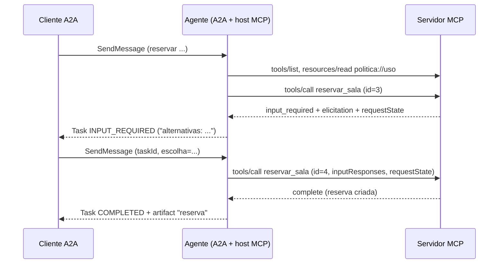

# 🚀 Desafio MBA Engenharia de Software com IA - Full Cycle


# 🌉 A Ponte: um agente A2A com MCP por dentro

Entrega do desafio **A Ponte** (MBA Engenharia de Software com IA, Full Cycle).

Dois processos separados, falando HTTP entre si:

| Processo | Pasta | Porta | Endpoints | Papel |
|---|---|:---:|---|---|
| 🧰 Servidor MCP | `servidor-mcp/` | `7301` | `/mcp` (Streamable HTTP) | Expõe as salas: 3 tools, 1 resource e o ciclo de MRTR |
| 🤖 Agente | `agente/` | `7300` | `/a2a` (JSON-RPC) e `/.well-known/agent-card.json` | Host MCP por dentro, servidor A2A por fora |



**Stack:** Python, SDK oficial `mcp==2.3.0` (MCP **2026-07-28**) e A2A **v1.0** (JSON-RPC 2.0) sobre Starlette, com versões travadas nos `pyproject.toml`/`uv.lock`. Sem LLM: o pedido tem formato fixo e o agente é determinístico.

---

## ▶️ Como rodar

**Pré-requisitos:** Python 3.11+ e [uv](https://docs.astral.sh/uv/getting-started/installation/). O validador usa só o Python 3.10+ do sistema.

```bash
git clone https://github.com/gustcoder/desafio-a2a-com-mcp.git
cd desafio-a2a-com-mcp
```

**1. Chave do `requestState`.** Obrigatória (sem valor padrão no código, mínimo de 32 bytes). Gere e exporte no terminal do servidor; nunca versione o valor:

```bash
export REQUEST_STATE_SECRET=$(python3 -c "import secrets; print(secrets.token_hex(32))")
```

**2. Terminal 1, servidor MCP (7301).** O stderr mostra cada request com `method`, `id`, `name`, `traceparent` e `retry=sim` no retry.

```bash
cd servidor-mcp && uv sync && uv run python servidor.py
```

**3. Terminal 2, agente (7300):**

```bash
cd agente && uv sync && uv run python agente.py
```

**4. Terminal 3, validador** (com os processos recém-iniciados, pois as reservas de uma execução afetam a seguinte):

```bash
python3 validador/validar.py --agente http://localhost:7300 --mcp http://localhost:7301
```

<details>
<summary>Variáveis de ambiente opcionais e teste à mão</summary>

| Variável | Padrão | Processo |
|---|---|---|
| `MCP_HOST` / `MCP_PORT` | `127.0.0.1` / `7301` | servidor MCP |
| `A2A_HOST` / `A2A_PORT` | `127.0.0.1` / `7300` | agente |
| `A2A_URL` | `http://<A2A_HOST>:<A2A_PORT>/a2a` | agente (URL do card) |
| `MCP_URL` | `http://127.0.0.1:7301/mcp` | agente |

```bash
curl -s http://localhost:7300/.well-known/agent-card.json

# sala ocupada: Task em TASK_STATE_INPUT_REQUIRED com "alternativas: sala-fusca, sala-mirante"
curl -s http://localhost:7300/a2a -H 'Content-Type: application/json' \
  -H 'traceparent: 00-4bf92f3577b34da6a3ce929d0e0e4736-00f067aa0ba902b7-01' \
  -d '{"jsonrpc":"2.0","id":1,"method":"SendMessage","params":{"message":{"messageId":"msg-1","role":"ROLE_USER","parts":[{"text":"reservar sala=sala-garagem inicio=2026-11-03T14:00:00-03:00 fim=2026-11-03T15:00:00-03:00 responsavel=Marty"}]}}}'

# continuação (troque <TASK_ID>)
curl -s http://localhost:7300/a2a -H 'Content-Type: application/json' \
  -d '{"jsonrpc":"2.0","id":2,"method":"SendMessage","params":{"message":{"messageId":"msg-2","role":"ROLE_USER","parts":[{"text":"escolha=sala-mirante"}],"taskId":"<TASK_ID>"}}}'

# só o lado MCP do agente, respondendo a elicitation à mão
cd agente && uv run python demo_host_mcp.py sala-garagem 2026-11-03T14:00:00-03:00 2026-11-03T15:00:00-03:00 Marty
```

</details>

---

## 🌉 Onde a ponte acontece

Na classe `Ponte`, em [`agente/ponte.py`](agente/ponte.py).

**MCP → A2A:** em `Ponte._aplicar` ([`ponte.py:167-169`](agente/ponte.py#L167-L169), marcado `>>> A PONTE`), o `input_required` do `tools/call` vira **`TASK_STATE_INPUT_REQUIRED`** com a linha `alternativas: <ids>`, na ordem do `enum` da elicitation. O agente recebe o resultado cru porque chama o SDK com `allow_input_required=True` e sem callback ([`cliente_mcp.py:189`](agente/cliente_mcp.py#L189)). O `requestState`, a chave do `inputRequests`, os argumentos e o trace ficam em `Ponte._pausas[task_id]`, fora do objeto `Tarefa`, que é o único serializado nas respostas A2A: o `requestState` não tem por onde vazar.

**A2A → MCP:** em `Ponte.continuar` ([`ponte.py:125`](agente/ponte.py#L125)), o `SendMessage` com `taskId` e `escolha=<valor>` recupera a pausa. Escolha fora do `enum` mantém a Task pausada. O retry ([`ponte.py:151-156`](agente/ponte.py#L151-L156)) repete o `tools/call` com a mesma tool e argumentos, `inputResponses` sob a **mesma chave**, o **`requestState` intacto** e id de JSON-RPC novo. `escolha=recusar` vira `action: "decline"` e a Task termina em `TASK_STATE_CANCELED`.

No servidor, o resolver `escolha_de_sala` ([`servidor.py:147`](servidor-mcp/servidor.py#L147)) devolve `Elicit(...)` quando há conflito, e o SDK responde `inputRequests` com um `requestState` selado.

---

## 🧠 Decisões técnicas

### Proteção do `requestState`

`RequestStateSecurity(keys=[segredo], ttl=600)` do próprio SDK ([`servidor.py:69`](servidor-mcp/servidor.py#L69)): cada estado é um envelope **AES-256-GCM** (cifra e autentica), com chave derivada de `REQUEST_STATE_SECRET` por HKDF-SHA256. O envelope amarra expiração, método, nome da tool, **digest dos argumentos** e audiência (`central-de-salas`).

| Situação | Resposta | Motivo no stderr |
|---|---|---|
| Estado adulterado | `-32602` | `rejected: seal` |
| Argumentos trocados no retry (servidor **rejeita o estado**) | `-32602` | `rejected: request binding` |
| Mais de **10 minutos** (`TTL_REQUEST_STATE = 600`) | `-32602` | `rejected: expired` |
| Restart com a mesma chave | aceito | – |
| Chave diferente | `-32602` | `rejected: unknown key` |

O servidor não guarda nada entre o `input_required` e o retry, por isso o retry funciona após um restart.

### Estado das Tasks

- **Tasks** em memória no `RegistroDeTarefas` ([`agente/tarefas.py`](agente/tarefas.py)), por id; não sobrevivem a restart (fora do escopo).
- **Máquina de estados** em uma tabela (`TRANSICOES`): transição ilegal levanta exceção e estados terminais não têm saída. `SendMessage` em Task terminal recebe `-32004`.
- **Pausas** em `Ponte._pausas`, por Task. Um `asyncio.Lock` por `Tarefa` serializa mensagens da mesma Task sem bloquear as outras, então Tasks simultâneas nunca trocam de `requestState`.
- **Reservas** em memória no servidor MCP ([`dominio.py`](servidor-mcp/dominio.py)), a partir de `dados/reservas.json`.

### Outras decisões

- **Domínio × protocolo:** `dominio.py` tem as regras puras; `servidor.py` só as traduz para MCP. No agente, `cliente_mcp.py` fala MCP, `tarefas.py` fala A2A e `ponte.py` costura os dois. As alternativas mostradas saem do `requestedSchema` do servidor, não de regra no agente.
- **Descoberta em runtime:** a cada Task nova, `tools/list` (argumentos montados a partir do `inputSchema`) e `resources/read politica://uso`, cuja primeira linha dá a versão gravada no artifact.
- **`traceparent`:** o trace-id do cliente A2A vai no `_meta` de todos os requests MCP da Task, inclusive o retry, com span-id novo em cada um.
- **Log:** middleware ASGI antes do SDK, para registrar até requests rejeitados (o logging do protocolo foi depreciado na 2026-07-28).
- **A2A à mão:** só `SendMessage` e `GetTask` são exigidos; sobre Starlette, a máquina de estados e o formato v1.0 ficam explícitos, sem as filas de eventos do `a2a-sdk`.
- **Transporte MCP:** `stateless_http=True` e `json_response=True`, sem `Mcp-Session-Id`.

### Limitação do SDK

O enunciado pede a capability exatamente `{"elicitation": {"form": {}}}` e o `input_required` cru. No `mcp==2.3.0`, a sessão só declara elicitation se houver `elicitation_callback`, e aí declara também o modo URL (`mcp/client/session.py`, `ClientSession._build_capabilities`):

```python
elicitation = (
    types.ElicitationCapability(form=types.FormElicitationCapability(), url=types.UrlElicitationCapability())
    if self._elicitation_callback is not _default_elicitation_callback
    else None
)
```

Passar a capability por request não adianta (o stamp a sobrescreve no `_meta`), e um callback faria o `Client` responder a elicitation sozinho, sem pausar a Task. A solução ([`cliente_mcp.py:116-129`](agente/cliente_mcp.py#L116-L129)) é uma subclasse de `Client` que troca **só** a construção das capabilities; headers, `_meta` e ids continuam com o SDK. Por usar um método privado, o SDK está travado em `mcp==2.3.0`.

---

## 📋 Saída do validador

Última execução, com processos recém-iniciados a partir de um clone limpo:

```text
trace-id desta execucao: 53cccd265c4baf5c01409299fec27110
procure esse valor no stderr do servidor MCP para conferir a propagacao do traceparent.

PASS 01 tools/list traz as tres tools
PASS 02 toda tool tem inputSchema de objeto
PASS 03 listar_salas devolve structuredContent e o mesmo JSON em texto
PASS 04 _meta sem protocolVersion devolve -32602 e HTTP 400
PASS 05 _meta sem clientCapabilities devolve -32602 e HTTP 400
PASS 06 tool inexistente e recusada, por -32602 ou por isError
PASS 07 resources/read de politica://uso devolve a politica
PASS 08 resources/read de URI inexistente devolve -32602
PASS 09 sala inexistente devolve isError com a mensagem exata
PASS 10 fora da janela devolve isError com a mensagem exata
PASS 11 duracao acima de 2h devolve isError com a mensagem exata
PASS 12 intervalo invertido devolve isError com a mensagem exata
PASS 13 conflito devolve input_required com inputRequests e requestState
PASS 14 a elicitation e form mode e oferece as alternativas na ordem certa
PASS 15 conflito sem a capability elicitation devolve -32021 e HTTP 400
PASS 16 retry com inputResponses e requestState conclui a reserva
PASS 17 requestState adulterado e rejeitado com -32602
PASS 18 argumentos adulterados no retry nao tomam efeito
PASS 19 recusa conclui sem reservar e sem isError
PASS 20 conflito sem alternativa possivel devolve isError com a mensagem exata

PASS 21 agent card responde 200 no well-known com JSON
PASS 22 o card declara a interface JSON-RPC com url e versao 1.0
PASS 23 o card declara a skill reservar-sala
PASS 24 SendMessage com sala livre conclui a Task
PASS 25 o artifact chama reserva e traz a versao da politica
PASS 26 GetTask devolve id, contextId e estado corrente
PASS 27 SendMessage com sala ocupada pausa a Task
PASS 28 a Task pausada lista as alternativas na ordem certa
PASS 29 escolha fora do enum mantem a Task pausada
PASS 30 a continuacao conclui a Task na sala escolhida
PASS 31 SendMessage em Task terminal e recusado
PASS 32 a recusa termina a Task em CANCELED
PASS 33 duas Tasks pausadas ao mesmo tempo concluem cada uma com a sua reserva
PASS 34 nenhuma resposta A2A carrega o requestState
PASS 35 sala inexistente termina a Task em FAILED com a mensagem da tool
PASS 36 o agente e deterministico: o mesmo pedido produz a mesma pausa

resumo: 36 passaram, 0 falharam, de 36 verificacoes
```

Conferível só no stderr do servidor MCP (fora do validador):

- **`traceparent`:** o trace-id da primeira linha do validador aparece nos requests do agente, começando por `tools/list` antes do primeiro `tools/call`.
- **Retry com id novo:** os dois `tools/call` de uma reserva pausada têm ids diferentes; o segundo vem com `retry=sim`.

---

## 🗂️ Estrutura

```text
.
├── README.md
├── dados/                 (do starter, não alterado)
├── validador/             (do starter, não alterado)
├── exemplos/              (do starter, não alterado)
├── servidor-mcp/
│   ├── pyproject.toml     mcp==2.3.0, uvicorn
│   ├── uv.lock
│   ├── dominio.py         regras puras: política, conflitos, alternativas, reservas em memória
│   └── servidor.py        tools, resource, MRTR, requestState selado, log no stderr
└── agente/
    ├── pyproject.toml     mcp==2.3.0, starlette, uvicorn (sem SDK de LLM)
    ├── uv.lock
    ├── cliente_mcp.py     host MCP: descoberta, resource, tools/call com input_required cru
    ├── tarefas.py         Task A2A v1.0 e máquina de estados
    ├── ponte.py           a ponte: input_required ⇄ TASK_STATE_INPUT_REQUIRED
    ├── agente.py          Agent Card, JSON-RPC (SendMessage, GetTask)
    └── demo_host_mcp.py   demo do lado MCP, com a elicitation respondida à mão
```
